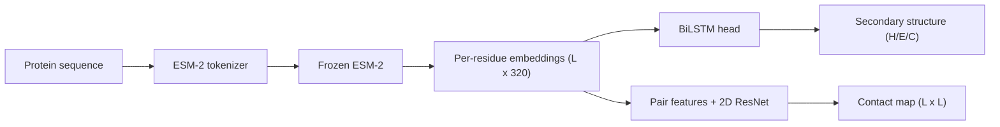
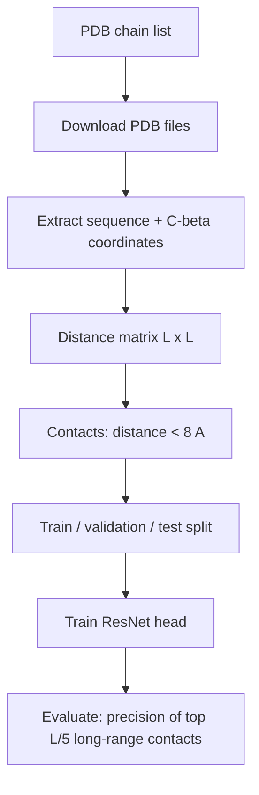

# Protein Structure Prediction with Deep Learning
 
Predicting protein structure information from the amino acid sequence alone, using a pretrained protein language model (**ESM-2**) and small task-specific neural networks.
 
> **Status:** work in progress. This repository contains the data pipeline and training code for two structure-prediction tasks. Results will be added as experiments finish.
 
---
 
## Table of contents
 
1. [What this project does](#what-this-project-does)
2. [Background in five minutes](#background-in-five-minutes)
3. [Tasks](#tasks)
4. [Pipeline](#pipeline)
5. [Models](#models)
6. [Data](#data)
7. [Repository structure](#repository-structure)
8. [Setup](#setup)
9. [Usage](#usage)
10. [Evaluation metrics](#evaluation-metrics)
11. [Design decisions](#design-decisions)
12. [Experiments planned](#experiments-planned)
13. [Limitations](#limitations)
14. [Future work](#future-work)
15. [References](#references)
16. [Disclaimer](#disclaimer)
---
 
## What this project does
 
Proteins are chains of amino acids that fold into specific 3D shapes. The shape decides what the protein does, so predicting it from the sequence is a central problem in biology, with uses in drug discovery, disease research and protein design.
 
Predicting the full 3D structure is a very large problem (AlphaFold-scale). This project tackles two well-defined pieces of it:
 
| Task | Question | Output |
|---|---|---|
| **1. Secondary structure** | For every residue, is it part of a helix, a strand or a coil? | One label per residue (H / E / C) |
| **2. Contact map** | For every pair of residues, are they close together in 3D? | An L x L matrix of contact probabilities |
 
Both tasks use the same idea: take a protein sequence, turn each residue into a rich numeric description, and train a small neural network on top to predict structure.
 
---
 
## Background in five minutes
 
- **Amino acids and residues.** A protein is a chain built from 20 types of amino acids. Each amino acid in the chain is called a *residue*. A sequence looks like `MKTAYIAKQRQISFVK...`.
- **Sequence determines structure.** The amino acid sequence alone is enough to determine the 3D shape (Anfinsen's principle), which is why prediction from sequence is possible.
- **Secondary structure.** Local patterns along the chain: alpha helices (**H**), beta strands (**E**) and coils/loops (**C**).
- **Contact map.** A symmetric matrix where entry (i, j) is 1 if residues i and j are within **8 angstroms** in 3D (measured between C-beta atoms; C-alpha for glycine). A good contact map summarises much of the fold.
- **Long-range contacts.** Pairs that are far apart in the sequence (separation of 24 or more) but close in 3D. They carry the information about how the chain folds back on itself.
- **ESM-2.** A Transformer protein language model pretrained on millions of sequences by predicting hidden amino acids. Its per-residue embeddings already encode evolutionary and structural information, so a small head can be trained on top with little labelled data (transfer learning).
---
 
## Tasks
 
### Task 1: Secondary structure prediction (3-state)
 
- **Input:** protein sequence.
- **Output:** H, E or C for each residue.
- **Models compared:**
  - **Baseline:** trainable amino acid embedding + BiLSTM (no pretrained knowledge).
  - **ESM model:** frozen ESM-2 embeddings + BiLSTM.
- **Metric:** Q3 accuracy (fraction of residues labelled correctly).
- The accuracy gap between the two models shows how much the pretrained model contributes.
### Task 2: Contact map prediction
 
- **Input:** protein sequence (50 to 300 residues).
- **Output:** probability that each residue pair is in contact (C-beta distance below 8 angstroms).
- **Model:** frozen ESM-2 embeddings, converted to pair features, then a dilated 2D residual network.
- **Metric:** precision of the top L/5 predicted long-range contacts (L = sequence length).
---
 
## Pipeline
 

 
Data flow for Task 2:
 

 
---
 
## Models
 
### Task 1: BiLSTM classifier
 
| Component | Setting |
|---|---|
| Input features | ESM-2 embeddings (L x 320) or learned 64-dim embeddings (baseline) |
| Recurrent layers | 2-layer bidirectional LSTM, hidden size 128 |
| Regularisation | Dropout 0.3 |
| Output | Linear layer to 3 classes (H, E, C) |
| Loss | Cross-entropy (padding positions ignored) |
| Optimiser | Adam, learning rate 1e-3 |
| Trainable parameters | about 0.86 M (ESM) / 0.60 M (baseline) |
 
A bidirectional LSTM is used because secondary structure depends on residues on both sides, and helices and strands are stretches rather than single residues.
 
### Task 2: Contact map network
 
| Step | Shape | Description |
|---|---|---|
| ESM-2 embeddings | (L, 320) | Frozen, one vector per residue |
| Linear projection | (L, 48) | Compress each residue vector |
| Pair features | (L, L, 145) | For each pair (i, j): vector i, vector j, their element-wise product, and log(1 + abs(i - j)) |
| 1x1 convolution | (64, L, L) | Mix pair features |
| 6 residual blocks | (64, L, L) | 3x3 convolutions with dilations 1, 2, 4, 8, 1, 2 (batch norm + ReLU) |
| 1x1 convolution | (1, L, L) | One logit per pair |
| Symmetrise | (L, L) | Average the map with its transpose |
 
- **Receptive field:** 73 x 73 pairs, enough to recognise helix packing and strand-pair patterns.
- **Loss:** binary cross-entropy with positive weight 10, because only about 1 to 3% of residue pairs are contacts. Pairs closer than 6 residues apart, and pairs with missing coordinates, are excluded.
- **Training:** one protein per step with gradient accumulation over 8 proteins; Adam, learning rate 1e-3.
- **Trainable parameters:** about 0.47 M (the ESM-2 model is frozen).
---
 
## Data
 
### Task 1
 
- Sequences with 3-state secondary structure labels (H, E, C). The default configuration loads a Hugging Face secondary-structure dataset (`proteinea/secondary_structure_prediction`, with CB513 as the test split). Dataset and column names may differ; the script prints the real column names on first run, so adjust the `--dataset`, `--seq_col`, `--ss_col` and `--test_split` flags if needed.
- A CSV with columns `sequence,ss3` can be used instead (`--csv`).
- Cleaning: sequence and label lengths must match, labels must be in {H, E, C}, and sequences longer than 400 residues are dropped.
### Task 2
 
- Protein chains from the **Protein Data Bank (PDB)**, listed as `pdbid_chain` (for example `1ubq_A`).
- Recommended source for the list: a **PISCES** culled list (at most 30% sequence identity, resolution 2.5 angstroms or better), so no near-duplicate proteins end up in both train and test.
- Chains with 50 to 300 residues are kept.
- Residues missing from the experimental structure are dropped (a known simplification).
---
 
## Repository structure
 
```
.
|-- common.py           # Loads frozen ESM-2, converts a sequence to per-residue embeddings
|-- ss_train.py         # Task 1: secondary structure (baseline and ESM models), reports Q3
|-- contact_prep.py     # Task 2 data prep: download PDB, build distance matrices
|-- contact_train.py    # Task 2: contact map network, reports precision of top L/5
|-- requirements.txt    # Python dependencies
`-- README.md
```
 
---
 
## Setup
 
Requirements: Python 3.9 or newer. A GPU is recommended (a free Google Colab GPU is enough); the 8M-parameter ESM-2 model also runs on CPU.
 
```bash
git clone <your-repository-url>
cd <your-repository-folder>
pip install -r requirements.txt
```
 
Dependencies: `torch`, `transformers`, `datasets`, `biopython`, `numpy`, `requests`, `tqdm`, `py3Dmol`.
 
The default ESM-2 model is `facebook/esm2_t6_8M_UR50D` (6 layers, 320-dim embeddings). Larger models (`esm2_t12_35M_UR50D`, `esm2_t30_150M_UR50D`) can be selected by changing `ESM_NAME` in `common.py`.
 
---
 
## Usage
 
### Task 1: secondary structure
 
```bash
# Baseline: learned embeddings only
python ss_train.py --model baseline
 
# With frozen ESM-2 embeddings
python ss_train.py --model esm
 
# Use your own CSV (columns: sequence, ss3)
python ss_train.py --model esm --csv my_data.csv
```
 
The best model (by validation Q3) is saved as `ss_baseline.pt` or `ss_esm.pt`, and test Q3 is printed at the end.
 
### Task 2: contact maps
 
```bash
# 1. Prepare data from a list of chains (one pdbid_chain per line)
python contact_prep.py chains.txt --max_len 300
 
# 2. Train and evaluate
python contact_train.py --data data/contacts --epochs 20
```
 
The best model is saved as `contact_net.pt`, and test precision of the top L/5 long-range contacts is printed at the end.
 
---
 
## Evaluation metrics
 
| Task | Metric | Definition |
|---|---|---|
| Secondary structure | **Q3** | Correctly labelled residues / all residues |
| Contact map | **Precision of top L/5 long-range contacts** | Rank all pairs with sequence separation of 24 or more by predicted score, take the top L/5, and measure the fraction that are true contacts |
 
Accuracy is deliberately not used for contacts: about 97% of pairs are not in contact, so predicting "no contact" everywhere would score about 97% while being useless.
 
### Results
 
_To be added after experiments._
 
| Experiment | Q3 | Contact precision (top L/5) |
|---|---|---|
| Baseline (learned embeddings) | - | - |
| Frozen ESM-2 | - | - |
 
---
 
## Design decisions
 
- **Frozen ESM-2 features.** Training only small heads is cheap, hard to overfit on a small dataset, and lets embeddings be cached. Fine-tuning is listed as future work.
- **Baseline comparison.** Every claim about ESM-2 is measured against a model without it, trained on the same data and split.
- **Leakage-aware splitting.** Proteins come in families of near-identical relatives. If relatives land in both train and test, scores are inflated. The data should be split by sequence-identity clusters (at most 30%), for example from a PISCES list or with MMseqs2 clustering, never by random chains from an unfiltered list.
- **Class imbalance.** Contacts are rare, so the loss up-weights them, and the evaluation metric is ranking-based.
- **Long-range focus.** Short-range pairs are almost always in contact and carry little information, so evaluation uses only pairs with sequence separation of 24 or more.
- **Dilated convolutions.** They give the 2D network a large receptive field without many extra parameters.
---
 
## Experiments planned
 
- Baseline vs ESM-2 for secondary structure.
- ESM-2 model size: 8M vs 35M vs 150M parameters.
- Head architecture: BiLSTM vs CNN vs Transformer.
- Number of residual blocks and channels in the contact network.
- Positive weight in the contact loss (1, 5, 10, 20).
- Training set size (25%, 50%, 100%).
- Frozen vs partially fine-tuned ESM-2.
- Contact precision by range (short, medium, long) and by protein length.
- Visualisation of predicted versus true contact maps and 3D structures (py3Dmol).
---
 
## Limitations
 
- No multiple sequence alignments (MSAs) or templates are used, unlike AlphaFold.
- Only short single chains (up to 300 residues) are handled.
- The contact map is a yes/no summary, not a full set of 3D coordinates.
- Residues missing from experimental structures are dropped, so residues next to a gap are treated as neighbours.
- Intrinsically disordered regions have no stable structure and cannot be predicted meaningfully.
- Results depend heavily on how the train/test split is built.
---
 
## Future work
 
- Predict **distance bins** (a distogram) instead of binary contacts.
- Reconstruct **3D coordinates** from predicted distances and evaluate with RMSD and TM-score.
- Add torsion-angle and solvent-accessibility prediction as extra tasks.
- Compare against ESMFold on the same proteins.
- Fine-tune ESM-2 (for example with LoRA).
- Add a Streamlit demo: paste a sequence, see secondary structure and a contact map.
---
 
## References
 
- Jumper et al., *Highly accurate protein structure prediction with AlphaFold*, Nature, 2021.
- Lin et al., *Evolutionary-scale prediction of atomic-level protein structure with a language model* (ESM-2 and ESMFold), Science, 2023.
- Rives et al., *Biological structure and function emerge from scaling unsupervised learning to 250 million protein sequences* (ESM-1b), PNAS, 2021.
- Rao et al., *Transformer protein language models are unsupervised structure learners*, ICLR, 2021.
- Kabsch and Sander, *Dictionary of protein secondary structure* (DSSP), Biopolymers, 1983.
- Wang and Dunbrack, *PISCES: a protein sequence culling server*, Bioinformatics, 2003.
- Steinegger and Soding, *MMseqs2 enables sensitive protein sequence searching and clustering*, Nature Biotechnology, 2017.
- RCSB Protein Data Bank: https://www.rcsb.org
- ESM models on Hugging Face: https://huggingface.co/facebook/esm2_t6_8M_UR50D
---
 
## Disclaimer
 
This project is for learning and research purposes only. Predicted structures and contacts are hypotheses, not experimentally verified facts, and must not be used for clinical or therapeutic decisions.
 
## Author
 
Maulik Kumar
